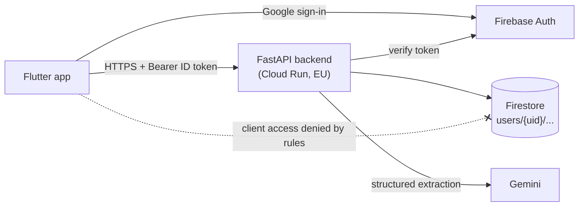

# bAIdget

**AI-assisted personal expense tracker.** Snap a receipt or a payment screenshot, and bAIdget reads it, picks the right category and saves the expense for you.

Built during a one-day hackathon for Hacktoberfest 2026: a Flutter mobile app and a FastAPI backend developed in parallel, with Google Gemini doing the receipt reading.

[View the hackathon submission on MLH](https://www.mlh.com/events/hacktoberfest-hack-day-milano-x-coding-bunker/submissions/01a14a07-ec0b-8893-8b60-eca85e30fdd3).

> **Status:** hackathon finished. The cloud deployment was shut down on 2026-10-17. The code, tests and docs stay here, and the backend runs locally with the Firebase emulators.

---

## What it does

| Feature | How it works |
|---|---|
| Google sign-in | Firebase Auth on the phone; the backend verifies the ID token on every request |
| Category onboarding | Pick at least 2 categories from a catalog (or a preset), add your own; `Other` is always there |
| Manual expenses | Create, edit, soft delete, filter and paginate. Safe to retry: the client generates the expense id |
| Receipt scan | One photo of a receipt, invoice or payment screenshot. Gemini extracts seller, date, total, items, VAT and payment method, chooses one of *your* categories and saves it. Uncertain results are flagged `needs_review` |
| Recurring expenses | Mark any expense as weekly, monthly or yearly. Missing occurrences are created when the app opens, never duplicated |
| Summaries | Monthly and yearly totals, per category and per month, with exact cent math and Europe/Rome month boundaries |

MVP scope: online only, EUR only, and each user sees only their own data.

## Architecture



- The app never touches Firestore directly; every read and write goes through the API.
- All data lives under `users/{uid}`, and the uid only ever comes from the verified token.
- Money is stored as integer cents and handled with `Decimal`, never floats.
- Receipt images are processed in memory (EXIF stripped, resized) and are never stored or logged.

More detail: [backend architecture](backend/specs/03-architecture.md), [data model](backend/specs/02-data-model.md), [API contract](backend/specs/frontend-handoff.md).

## Tech stack

| Layer | Tools |
|---|---|
| Mobile | Flutter, Firebase Auth, Google Sign-In |
| API | Python 3.12, FastAPI, Pydantic, conda |
| Data | Cloud Firestore (async client, transactions, composite indexes) |
| AI | Google Gemini via `google-genai`, JSON schema structured output |
| Quality | pytest against Firebase emulators, ruff, OpenAPI snapshot and contract tests |
| Delivery | Docker, GitHub Actions CI, Cloud Run deploy with keyless Workload Identity Federation |

## How it was built

The backend was built with an **agent orchestration workflow**:

1. **Spec first.** A data model, an architecture doc and an API contract for the app developer, plus a list of open questions settled before coding.
2. **Vertical slices.** Eight slices (scaffold, auth, categories, expenses, summaries, recurring, scan, hardening), each with acceptance criteria and required tests.
3. **Delegated implementation.** Claude acted as orchestrator and reviewer; OpenAI Codex implemented each slice in its own git worktree. Summaries, recurring and scan were built in parallel.
4. **Review gate.** Every slice was checked against a hard checklist (user isolation, money rules, soft delete, idempotency, no personal data in logs) and its tests were run on the emulators before merging.

Review caught real bugs before users did, including a Firestore SDK transaction bug and a Gemini schema incompatibility found while testing a real receipt.

**Result:** 21 endpoints, 90 automated tests, CI green on every merge, and an end-to-end test that read a real Milan restaurant receipt correctly (seller, 18.30 EUR total, VAT, card payment, "Dining Out" category).

## Repository layout

```
lib/        Flutter app (auth, onboarding, upload, expenses, categories, settings)
backend/    FastAPI service, tests, specs, Dockerfile, GCP bootstrap script
_Wiki/      Shared product and engineering wiki
.github/    CI and deploy workflows
```

## Run it locally

**Backend** (needs conda, Java and `firebase-tools`):

>NOTE: You need to add your own Firebase project and set your own environment variables.

```bash
cd backend
conda env create -f environment.yml
firebase emulators:exec --project demo-baidget --only firestore,auth \
  'conda run -n baidget pytest -q'
```

See [backend/README.md](backend/README.md) for environment variables and running the API.

**App:** with no API URL and `USE_FIREBASE=false`, the app runs on fake auth and in-memory data, so `flutter run` works without a backend. See [contributing](_Wiki/development/contributing.md).

## Future work

- Family and shared groups
- Importing expenses from e-mail
- Bulk and background scanning
- Speech-to-text expense entry
- Multiple currencies
- Budgets and alerts
- Offline mode with sync
- Scheduled recurring generation instead of on app open

## Documentation

- [Project wiki](_Wiki/index.md), [current state](_Wiki/current-state.md), [open questions](_Wiki/open-questions.md)
- [API contract](backend/specs/frontend-handoff.md) and [`openapi.json`](backend/openapi.json)
- [Agent instructions](AGENTS.md)

All documentation and code comments are in English.

## License

[Apache License 2.0](LICENSE)
