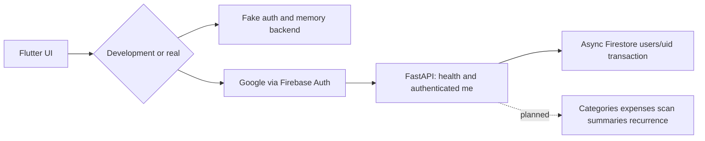

# Architecture and technology registry

Evidence: frontend `6d9baea`, backend `18c0d19`, [ADR-0005](../decisions/adr-0005-api-handoff-baseline.md), [ADR-0006](../decisions/adr-0006-integrated-client-and-backend.md). This page distinguishes source implementation from the full [API contract](contracts.md) and deployment targets.

## Implemented client and server structure

[main.dart](../../lib/main.dart) initializes Firebase only with USE_FIREBASE=true, obtains SharedPreferences, then runs a Riverpod ProviderScope/[BaidgetApp](../../lib/app.dart). Profile/onboarding gates lead to the upload screen; settings persist an API URL, and expense detail is read-only. Default empty URL uses [MockBackend](../../lib/core/network/mock_backend.dart); default auth is fake. Mock scans return synthetic data, never OCR results or durable financial storage.

Client boundaries: [Firebase auth adapter](../../lib/core/auth/firebase_auth_service.dart), [token interceptor](../../lib/core/network/auth_interceptor.dart), Dio API client, account/category/scan repositories, model parsers, gallery preparation, status widgets and design tokens. Category CRUD beyond onboarding/read, manual expense CRUD, editable scan review, summaries and recurrence UI are incomplete.

Backend [app factory](../../backend/app/main.py) installs error handlers/request logging, shared Firestore lifespan and only health/me routers. [current_user](../../backend/app/core/auth.py) verifies Firebase tokens in a threadpool; [user service](../../backend/app/services/users.py) shapes responses; [repository](../../backend/app/repositories/users.py) transactionally gets/creates users/{verified_uid}. Firestore imports are confined to repositories. Generated API schema is /v1/openapi.json, not a complete committed contract snapshot.

## Dependency/tooling registry

| Area | Declared/observed evidence | Verification limit |
| --- | --- | --- |
| Flutter/Dart | Root manifest: baidget 1.0.0+1, Dart ^3.13.4; no exact Flutter release pin | Flutter/Dart not available for tests/builds in this session |
| Client packages | [Manifest/lockfile](../../pubspec.yaml): Dio 5.11.1, Riverpod 3.4.3, Firebase Core 5.0.0/Auth 7.0.0, Google Sign-In 7.2.0, preferences 2.5.6, UUID 4.6.0, picker 1.2.4, compression 2.5.1, Intl 0.20.3, http_parser 4.1.2, path_provider 2.1.6; existing icons/lints | Versions are repository declarations/resolutions, not a tested Android toolchain |
| Android | [App Gradle](../../android/app/build.gradle.kts): minimum API 24, Java/Kotlin 17; AGP 9.1.0, Kotlin 2.4.0, Gradle 9.3.1 | Network enabled; HTTP cleartext allowed only in debug; example app ID/debug release signing still need provider/release review |
| iOS/other runners | Photo-library/local-network descriptions and plugin registrants updated | No platform build/support expansion verified |
| Backend runtime | [environment.yml](../../backend/environment.yml): Conda env baidget, Python 3.12, pip dependencies; pyproject configures Ruff/pytest | Conda unavailable here; temporary Python 3.12.14 venv used for verification; package versions unpinned in manifest |
| Backend libraries | FastAPI, Uvicorn, pydantic-settings, Firestore/Firebase Admin, google-genai, Pillow, multipart, pytest/asyncio/httpx/Ruff | Exact test environment and observed results in [integration review](../development/integration-review.md); no dependency additions during merge |
| Data access | AsyncClient; [deny-all rules](../../backend/firestore.rules); empty current indexes | Current source has profile access only; future expense query indexes in specs are not implemented |
| CI/container | [Workflow](../../.github/workflows/ci.yml): Conda, Java 21, Node 22, Firebase emulators, Ruff/pytest; non-root Python 3.12 Docker image | Workflow/container files are present; Docker build and hosted CI execution unverified locally |
| Deployment/extraction | Backend architecture targets Cloud Run EU/Gemini; env template names Gemini model/key | No deployment or extraction code; env model string is not a validated provider/model decision |
| Planned persistence | Backend specs propose integer cents, Decimal conversion, Rome recurrence anchors and caps | Source records proposals as adopted internally; independent human approval not evidenced here and domain code absent |

The Firebase client SDK is Auth-only; business data goes through the API. Direct client Firestore denial is required by source rules but production deployment/access is unverified. Google/Firebase project/config credentials remain missing.

## Integration and contract limits

The default mock route set is broader than the actual server: onboarding/category/scan/sync calls cannot currently complete against dev backend. Do not mark an API implemented because a frontend mock responds. Offline sync, email, budgets, family and other currencies remain outside current scope.

See [contracts](contracts.md), [AI/data](ai-and-data.md), [integration review](../development/integration-review.md), [frontend](../development/frontend-tracker.md), [backend](../development/backend-tracker.md), and [infrastructure](../development/infrastructure-tracker.md). Preserve the original scaffold decision as history rather than using its counter inventory as current behavior.
