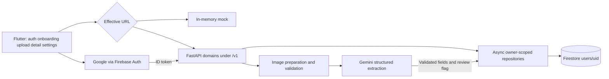

# Architecture and technology registry

Source baseline: main `b6d984e`; [audit](../development/repository-audit.md), [ADR-0007](../decisions/adr-0007-merged-backend-baseline.md). The [earlier integration](../development/integration-review.md) remains historical evidence for the smaller backend. Current API behavior and deviations are in [contracts](contracts.md).

## Implemented structure

[main.dart](../../lib/main.dart) conditionally initializes Firebase, obtains SharedPreferences and starts Riverpod. [app.dart](../../lib/app.dart) gates sign-in → profile → onboarding → upload. Firebase and fake auth are separate from the URL-selected HTTP/mock mode. Settings URL overrides `API_BASE_URL`; empty effective URL selects the memory adapter. Business records are never read through client Firestore. The mock is synthetic and process-local, not offline storage.

Flutter repositories currently cover `/me`, catalog/onboarding/category read, scan and recurrence sync only. [AuthInterceptor](../../lib/core/network/auth_interceptor.dart) attaches tokens, refreshes once on 401 and clones multipart for retry. Detail renders the uploaded object without fetching it again. No manual/list/PATCH/delete/summary/rule-management client exists. Material 3 light/dark semantic tokens and en_US/EUR/device-local date formatters exist; these are presentation choices, not server timezone settings.

[FastAPI factory](../../backend/app/main.py) registers health, me, categories, expenses, scan, recurring and summary routers, JSON errors and request logging. HTTP dependencies derive UID from verified Firebase tokens; synchronous verification runs in a threadpool. Services implement money, category constraints, extraction/review, recurrence and aggregation. Only repositories import Firestore and use an application-lifetime AsyncClient. [Gemini](../../backend/app/llm/gemini.py) uses the async google-genai client; [Pillow](../../backend/app/imaging/image.py) processing runs in a threadpool.

## Data and execution boundaries

Profiles, categories, expenses, recurring rules and scan quota metadata live below `users/{uid}`; details in [domain model](domain-model.md). Category onboarding/uniqueness/archiving, expense mutations, quota consumption and each rule sync use transactions. Category validation for expense/rule writes is a separate read, not a cross-domain atomic invariant.

A scan checks an existing live ID first, reads/validates/re-encodes the image, loads active user categories, consumes quota, calls Gemini, validates output and saves an expense transactionally. A retry avoids duplicate persistence; concurrent first scans can still invoke the provider more than once. General expense reads and scan responses currently use different scan-details serializers: a recorded integration defect.

Recurring generation is request-driven, no cron/queue/worker exists. It anchors dates to Europe/Rome, derives deterministic UUIDv5 occurrence IDs and materializes up to 50 indexes per rule, 20 active rules per sync. The client starts sync on entering home/resume and makes at most five calls; see [review](../development/integration-review.md#post-merge-audit-at-b6d984e) for completion issues. Summaries stream all matching expenses and aggregate cents in Python, with category lookups per populated category. No rollup/cache/Firestore aggregate query is implemented.

## Dependency and tooling registry

| Area | Source declaration / resolution | Limit |
| --- | --- | --- |
| Flutter/Dart | baidget 1.0.0+1; Dart `^3.13.4`; lockfile Dart >=3.13.4 <4 and Flutter >=3.47.0 | No exact Flutter pin or executed client check in this audit |
| Client state/network/auth | Riverpod 3.4.3, Dio 5.11.1, Firebase Core 5.0.0/Auth 7.0.0, Google Sign-In 7.2.0 | [pubspec](../../pubspec.yaml) constraints and [lock](../../pubspec.lock) resolutions; adapters exist, real setup unverified |
| Client input/storage/formatting | picker 1.2.4, compression 2.5.1, UUID 4.6.0, preferences 2.5.6, Intl 0.20.3, http_parser 4.1.2, path_provider 2.1.6, icons 1.0.9, lints 6.0.0 | Preferences stores URL, not expense persistence; path_provider is declared without direct app usage |
| Android | API floor 24; Java/Kotlin 17; AGP 9.1.0, Kotlin 2.4.0, Gradle 9.3.1 | Example application ID and debug release signing; no Google Services plugin/config committed |
| Other platforms | Generated iOS/macOS/web/Linux/Windows projects and plugin registrants | Platform presence is not support: gallery file-path compression, Google auth and entitlements need separate validation; web backend CORS middleware absent |
| Python | Conda `baidget`, Python 3.12 in [environment.yml](../../backend/environment.yml); Python 3.12 Docker base | Unpinned pip packages; audit interpreter Python 3.13.0 only parses/probes stdlib code |
| API/data/provider | FastAPI, Uvicorn standard, pydantic-settings, firebase-admin, google-cloud-firestore, google-genai, Pillow, python-multipart | Purpose: HTTP/config/auth/storage/structured extraction/image/multipart; no backend dependency lock |
| Verification | pytest, pytest-asyncio, httpx, Ruff; CI Java 21/Node 22 and unpinned firebase-tools | Test source exists, full audit runtime unavailable; earlier temporary package resolutions are historical |
| Deployment | Cloud Run, Artifact Registry, Firebase/Firestore, Secret Manager, GitHub OIDC/WIF | Concrete definitions in [infrastructure](infrastructure.md); endpoint currently returned service errors |

These are observed merged choices, not a newly performed library comparison or independent approval of every backend proposal. No dependency was added during reconciliation. [ADR-0006](../decisions/adr-0006-integrated-client-and-backend.md) records the earlier choices; [ADR-0007](../decisions/adr-0007-merged-backend-baseline.md) extends their implementation evidence. Email, budgets, sharing, currencies and offline synchronization remain outside scope.
