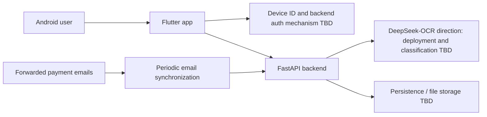

# Architecture and technology registry

Sources: [updated specification](../raw/2026-10-17-updated-specification.md), [ADR-0004](../decisions/adr-0004-updated-product-baseline.md), and [scaffold ADR-0003](../decisions/adr-0003-flutter-scaffold.md). Android/Flutter/FastAPI/Firebase are the current human-supplied direction; detailed boundaries below remain proposed. Only Flutter's counter scaffold exists at `055275e`. [ADR-0002](../decisions/adr-0002-initial-stack.md) preserves the superseded initial proposal.

## Observed scaffold and execution flow

The package lives at the repository root, with a single Dart application file, [lib/main.dart](../../lib/main.dart). `main()` calls `runApp(const MyApp())`; `MyApp.build()` creates a `MaterialApp` titled `Flutter Demo`, a deep-purple color scheme, and `MyHomePage`. `_MyHomePageState` holds an integer counter initialized to zero. The floating action button calls `_incrementCounter()`, which increments it inside `setState`; the rebuilt widget displays the new value. There is no persistence or service call.

[test/widget_test.dart](../../test/widget_test.dart) pumps `MyApp`, checks `0`, taps `Icons.add`, pumps again, and checks `1`. This describes source assertions, not an executed test result. State handling uses Flutter's built-in `StatefulWidget`/`setState`; no application router, API client, expense domain classes, or additional state library is implemented. The source-defined expense fields exist only in documentation. Generated native plugin lists are empty, for example [Windows plugins](../../windows/flutter/generated_plugins.cmake).

Platform runners are generated infrastructure, not completed expense screens or verified builds. The iOS/macOS `RunnerTests` contain placeholder `testExample` methods without assertions. See [development setup](../development/contributing.md) for paths and tool availability.

## Intended component boundaries

Firebase is named in the updated stack, but its exact services are unresolved. The device ID/fingerprint requirement does not select Firebase Authentication or establish a backend credential. Do not read the diagram as a choice of Firestore, Cloud Storage, deployment platform, or implemented auth. Job workers remain tentative; no queue/scheduler is selected.

| Component | Proposed responsibility | Unresolved boundary |
| --- | --- | --- |
| Flutter Android client | Automatic device identity, category setup, gallery selection, shared OCR/manual form, summaries and later budgets | Secure identity/session, optional camera, state/navigation/networking, Firebase usage |
| FastAPI backend | Authenticated operations, ownership checks, input validation, extraction orchestration, persistence access | Token issuer/verification, API shape, synchronous vs asynchronous extraction |
| Identity mechanism | Stable smartphone ID/fingerprint mapped to an owner and backend session | Generation/storage, proof of possession, recovery/device lifecycle; no Google flow currently required |
| Data/file services | Durable user/category/expense data and receipt files if retained | Firebase services, database choice, access model, retention |
| OCR / classification | DeepSeek-OCR named for receipt reading; classify with user categories | Exact variant/host, additional classification stage, schema, latency/cost/accuracy |
| Email synchronization | 3.0: periodically read app-managed receipts and map to owners; address generation timing open | AgentMail to evaluate, mailbox model, worker placement, polling/retry |
| Budgets/alerts | 4.0: budget creation and 25/50/75/100% notifications; per-category option | Schema, periods, notification delivery, deduplication/reset |

These are logical responsibilities; they do not require separate deployable services. Choose the simplest topology that satisfies the agreed demo.

## Technology and library registry

| Technology or area | Status | Version / manifest | Decision or next evidence |
| --- | --- | --- | --- |
| Android | Product target; generated runner present | AGP `9.1.0`, Kotlin plugin `2.4.0`, Gradle distribution `9.3.1`; Java/Kotlin target 17 | [settings](../../android/settings.gradle.kts), [wrapper properties](../../android/gradle/wrapper/gradle-wrapper.properties), [app build](../../android/app/build.gradle.kts); SDK levels delegate to Flutter |
| Flutter / Dart | Client scaffold present; runtime unverified | [pubspec.yaml](../../pubspec.yaml): Dart `^3.13.4`, package `baidget` `1.0.0+1`; no exact Flutter release pin | [ADR-0003](../decisions/adr-0003-flutter-scaffold.md); [metadata](../../.metadata) records stable revision `6a19cca56475dbfba1478ee68d7bd0c2ef891da1`, not an installed SDK check |
| Flutter package dependencies | Generated defaults; no product SDKs | `cupertino_icons` constraint `^1.0.8`, locked `1.0.9`; SDK `flutter`; dev SDK `flutter_test`, `flutter_lints` `^6.0.0` locked `6.0.0` | [Manifest](../../pubspec.yaml), [lockfile](../../pubspec.lock); icons, widget testing, recommended lints; no dependency alternatives evaluation recorded |
| FastAPI / Python | Updated stack direction; not implemented | No manifest/runtime pin | ADR-0004; backend infrastructure is milestone 0.1 |
| Firebase | Updated stack direction; services unspecified | No configuration/SDK | Decide auth/database/storage roles; no service inferred |
| Device identity/auth | Smartphone ID/fingerprint requirement replaces Google sign-in | No identifier/session SDK or contract | Q-03: mechanism, backend proof, recovery |
| OCR / classification | DeepSeek-OCR named; no integration | Variant/version/host, SDK, prompt/schema and classifier unspecified | Q-05; reference/evaluation limits in AI/data |
| Email ingestion | 3.0 requirement; AgentMail to evaluate | No SDK/worker/provider configuration | Q-06; periodic sync remains the requirement |
| Workers/scheduling | Tentative job workers; optional recurring cron/fixed expenses | No queue/scheduler selected | Do not infer automatic recurrence or email infrastructure |
| Flutter state/router/network libraries | Built-in `setState` for the demo; no extra libraries | [main.dart](../../lib/main.dart) | Product state/navigation/networking remain open |
| Database, migrations, file storage | Unselected | None | Resolve domain persistence and access paths |
| Testing, formatting, linting, CI | Counter widget test and analyzer configuration present; no CI | [Test](../../test/widget_test.dart), [analyzer](../../analysis_options.yaml) includes `package:flutter_lints/flutter.yaml` and excludes generated platform folders/build | `flutter test` and `flutter analyze` not executed in the integration session |
| Hosting and deployment | Server deployment planned in 2.0; target unselected | None | Record chosen server, configuration, actual verification |

For each new dependency, record purpose, actual version or manifest path, decision status/rationale, and operational constraints. Runtime and library documentation should be checked against the selected version when needed. Do not invent a package or install command to fill this table.

The lockfile declares Dart `>=3.13.4 <4.0.0` and Flutter `>=3.18.0-18.0.pre.54`; its Flutter lower bound does not identify the SDK used to generate the project. Do not infer a release number from the metadata revision. Build-tool compatibility has not been tested here.

Android currently uses placeholder namespace/application ID `com.example.baidget`, Flutter-provided `compileSdk`, `minSdk`, `targetSdk`, and NDK versions, and debug signing even for the release build. The [main manifest](../../android/app/src/main/AndroidManifest.xml) has no camera permission; Internet permission is present only in debug/profile manifests. These defaults require review when implementing services or release packaging. No numeric Android SDK floor is established independently of the chosen Flutter SDK.

## Cross-component changes

Changes to ownership, persistence, category identifiers, extraction output, or error states affect both app and backend. Update [contracts](contracts.md), [domain model](domain-model.md), the relevant [decision](../decisions/index.md), and any affected [flows](../product/user-flows.md) in the same task. Add the actual source paths to the [development guide](../development/contributing.md) once they exist.
