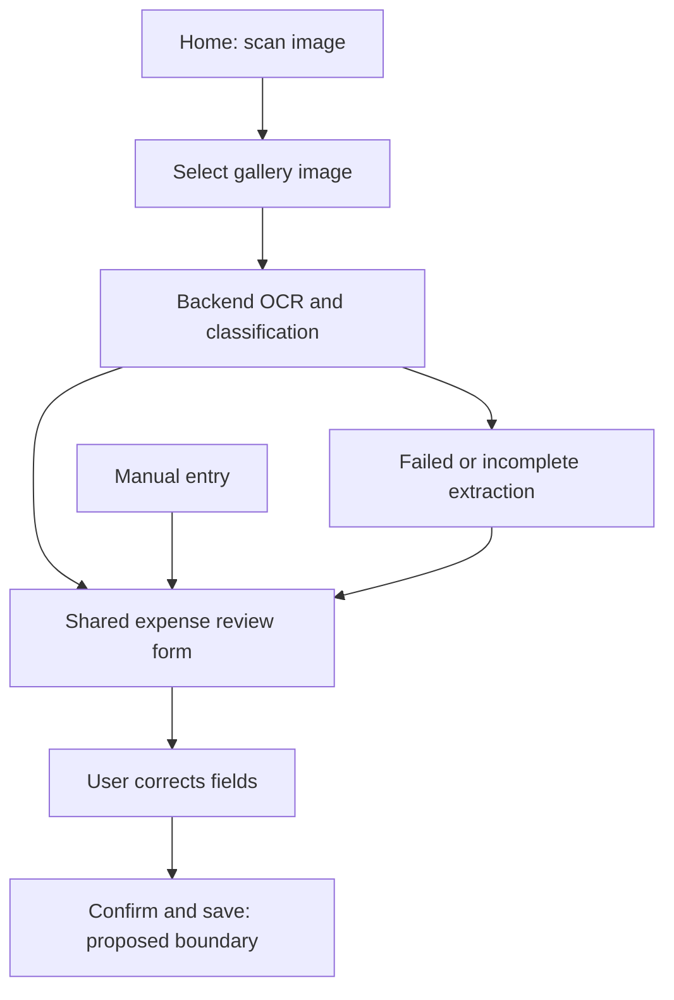

# User flows

Source: [updated specification](../raw/2026-10-17-updated-specification.md), [ADR-0004](../decisions/adr-0004-updated-product-baseline.md). **Required** denotes source requirements; proposed recovery/save mechanics need contracts. At `055275e` the only app screen is the [counter demo](../../lib/main.dart). These product flows are not built/tested.

## Automatic identity, categories, and home

1. **Required, 1.0:** automatically identify/authenticate through a smartphone-generated unique ID/fingerprint, stable across logins from that smartphone. The old Google sign-in direction is superseded.
2. **Open:** technical meaning of fingerprint, backend ownership proof/session, and reinstall/reset/device-change recovery. Do not infer biometric authentication or a specific Android identifier/API.
3. **Required:** offer predefined templates (four/six starting categories) or creation from scratch. The narrative allows rename/add/remove on a selected template.
4. **Open:** template selection is in 1.0; editing is in 2.0. Clarify whether onboarding customization is in 1.0 or all edits wait (Q-10).
5. **Required:** after setup, home offers scan image, import expense, and expense summary. **Proposed:** preserve returning-user configuration and expose manual entry through import expense; exact navigation is unspecified.

Address generation is described at user creation although email import lands in 3.0. Decide provisioning timing (Q-06), empty-category completion, and account/session recovery.

## Gallery receipt import and review

The detailed **required** flow starts by selecting an existing gallery image. Milestone 1.0 separately lists receipt scanning; additional direct camera capture remains unresolved (Q-15), rather than inherited automatically from the old brief.

Extraction/classification uses the user's categories; users can always correct results. The explicit confirmation/save boundary is proposed. Model output is a draft, not trusted saved data. Fields and optional amount handling follow the [model](../engineering/domain-model.md) and open [contracts](../engineering/contracts.md).

**Proposed recovery states:** picker cancellation/access denied, preview/reselect, uploading/extracting, incomplete draft, saving/saved, retry/failure. Preserve edits after recoverable errors; validate media/size; never invent missing values. Formats, limits, timing, and separate OCR/classification stages are unspecified.

## Shared manual-entry form

**Required, 1.0:** manual input is always available and uses the same screen as post-scan validation, without requiring an image/OCR. **Proposed:** start with an empty draft, apply agreed defaults, validate, confirm/save, and preserve recoverable edits.

Use source fields such as `date`, `seller`, `title`, `category`, `type`, `description`, `amount`, and `currency`. Ownership/creation metadata are not trusted form inputs. Amount is explicitly optional; saving and summary treatment for missing amounts are still open.

Single/recurring purchases are mentioned alongside literal `concurrent` and unspecified `info`. Schedule, next occurrence, series edits, fixed expenses, and cron generation are not defined or implemented.

## Forwarded-email import

**Required, 3.0:** forward payment receipts to a system-generated user address; backend periodically synchronizes received messages. AgentMail is an evaluation candidate. No OAuth access to users' personal mailboxes is established.

**Proposed:** map recipient to owner, deduplicate delivery, safely extract/validate, and expose a draft. **Open:** confirmation policy, pending-import UI, attachments, polling/retries, unknown recipients, and address lifecycle. Webhooks would change the stated periodic-sync approach and need a decision.

## Summaries and comparison

**Required, 2.0:** browse weekly/monthly/yearly and by category; compare current/previous week/month/year. The source requests a category pie chart and mentions bar charts. Optional category granularity does not yet define a hierarchy.

**Open, Q-17:** default charts/comparisons in 2.0 versus selectable types in 5.0. **Proposed:** empty states and refresh after save/correction. Timezone/week starts, partial-period comparisons, null amounts, currencies, deletion, and recurrence need aggregation rules.

## Budgets and notifications

**Required, 4.0:** create budgets and notify at 25%, 50%, 75%, 100%; per-category alerts are optional. Budget periods, amount representation, configurable thresholds, repeated crossings/alerts, reset, edits/deletions, notification channel/permissions remain open (Q-18). No notification infrastructure is selected.

Related: [scope/milestones](scope.md), [model](../engineering/domain-model.md), [contracts](../engineering/contracts.md), [AI/data](../engineering/ai-and-data.md), [questions](../open-questions.md).
