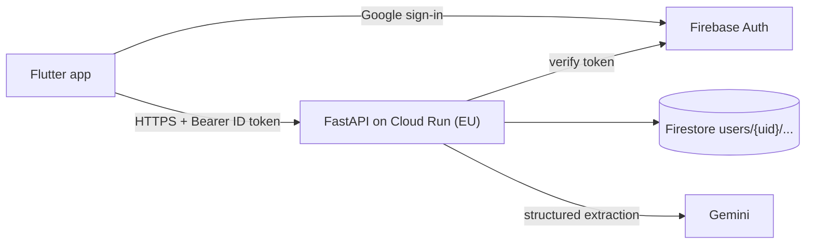

# bAIdget — backend

FastAPI + Firestore + Firebase Auth backend for the bAIdget expense tracker (Flutter client). Gemini extracts expenses from receipt and payment screenshots.


Details: [`specs/03-architecture.md`](specs/03-architecture.md). Data model: [`specs/02-data-model.md`](specs/02-data-model.md). API contract: [`specs/frontend-handoff.md`](specs/frontend-handoff.md).

## Setup

```bash
conda env create -f environment.yml
conda activate baidget
uvicorn app.main:app --reload
```

## Environment variables

| Variable | Default | Purpose |
|---|---|---|
| `GOOGLE_CLOUD_PROJECT` | `demo-baidget` | Google Cloud/Firebase project id |
| `FIRESTORE_EMULATOR_HOST` | unset | Firestore emulator host, for example `127.0.0.1:8080` |
| `FIREBASE_AUTH_EMULATOR_HOST` | unset | Firebase Auth emulator host, for example `127.0.0.1:9099` |
| `GEMINI_API_KEY` | unset | Gemini API credential; required for live scanning |
| `GEMINI_MODEL` | `gemini-flash-latest` | Gemini model used for extraction |
| `GEMINI_TIMEOUT_SECONDS` | `30` | Extraction timeout in seconds |
| `SCAN_RATE_LIMIT_PER_HOUR` | `30` | Per-user scan limit |
| `MAX_IMAGE_BYTES` | `10485760` | Maximum uploaded image size |
| `TZ_NAME` | `Europe/Rome` | Time zone for reporting and recurrence boundaries |

## Emulators and tests

Install Firebase CLI and Java, then run the emulator-backed suite:

```bash
firebase emulators:exec --project demo-baidget --only firestore,auth \
  'conda run -n baidget pytest -q'
conda run -n baidget ruff check .
conda run -n baidget ruff format --check .
```

## API overview

The API is rooted at `/v1`; `GET /health` is the unauthenticated health check. Interactive docs are at `/v1/docs`. See the [frontend handoff](specs/frontend-handoff.md) for behavior and [openapi.json](openapi.json) for the machine-readable contract.

Regenerate the schema after changing a route or API model:

```bash
conda run -n baidget python scripts/export_openapi.py
```

## Handoff to DevOps

- Build and run the included `Dockerfile`; deployment itself is outside this repository slice.
- Configure the environment variables above. Provide `GEMINI_API_KEY` from Secret Manager, not as an image build argument or committed value.
- Deploy `firestore.rules` and `firestore.indexes.json` to the production Firebase project.
- Keep Cloud Run and Firestore in an EU region and set `GOOGLE_CLOUD_PROJECT` to that project.
- Enable the Google sign-in provider in Firebase Auth and configure its authorized domains and client applications.
