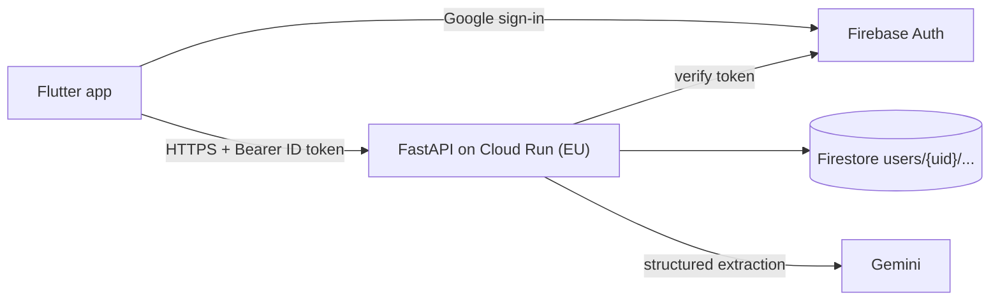

# bAIdget — backend

FastAPI + Firestore + Firebase Auth backend for the bAIdget expense tracker (Flutter client). Gemini extracts expenses from receipt and payment screenshots.


Details: [`specs/03-architecture.md`](specs/03-architecture.md). Data model: [`specs/02-data-model.md`](specs/02-data-model.md). API contract: [`specs/frontend-handoff.md`](specs/frontend-handoff.md).

## Status
Planning (Step 1). The code arrives slice by slice; see `specs/tasks/`.

## Dev setup (target, available after slice 00)
```bash
conda env create -f environment.yml && conda activate baidget
firebase emulators:start --only firestore,auth   # needs firebase-tools + Java
ruff check . && ruff format --check . && pytest
uvicorn app.main:app --reload
```
