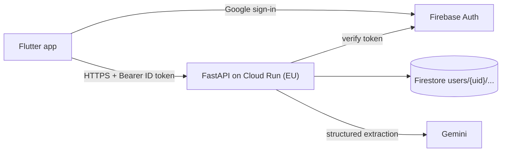

# bAIdget — backend

FastAPI + Firestore + Firebase Auth backend for the bAIdget expense tracker (Flutter client). Gemini extracts expenses from receipt and payment screenshots.


Details: [`specs/03-architecture.md`](specs/03-architecture.md). Data model: [`specs/02-data-model.md`](specs/02-data-model.md). API contract: [`specs/frontend-handoff.md`](specs/frontend-handoff.md).

## Status
Slices 00 (service scaffold) and 01 (Firebase auth and profile) are present. Implemented application endpoints are `GET /health` and `GET /v1/me`; the other handoff endpoints remain planned. The generated schema is served at `/v1/openapi.json`, but no complete committed snapshot exists yet. See `specs/tasks/` and the shared [backend tracker](../_Wiki/development/backend-tracker.md) for remaining work and actual verification.

## Development setup
```bash
conda env create -f environment.yml
conda activate baidget
ruff check .
ruff format --check .
firebase emulators:exec --project demo-baidget --only firestore,auth "python -m pytest -q"
```

Run commands from `backend/`. The Firebase CLI and Java are additional emulator prerequisites. `emulators:exec` starts the local Auth/Firestore emulators and exports their host variables to the test process; plain `pytest` without both host variables is rejected before a database client starts. Tests must never use live Firebase or Gemini services.

For local API development, run `firebase emulators:exec --project demo-baidget --only firestore,auth "uvicorn app.main:app --reload"`, which supplies the same emulator host variables. Alternatively start emulators separately and explicitly export the required variables, or use `uvicorn app.main:app --reload --env-file .env` with a local copy of `.env.example`. Settings do not automatically read `.env`. Never commit `.env`, provider keys or emulator debug logs.

The root Flutter client defaults to fake auth and an in-memory backend. Real Google authentication needs Firebase platform configuration and `USE_FIREBASE=true`; setting an API URL alone does not enable real auth. The incomplete backend cannot yet finish category onboarding or accept scans. The architecture diagram includes target Cloud Run/Gemini components; it is not evidence of a deployment or extraction implementation.
