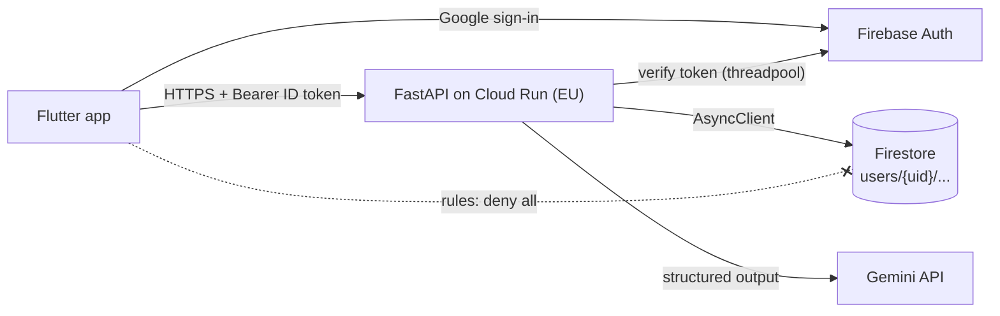
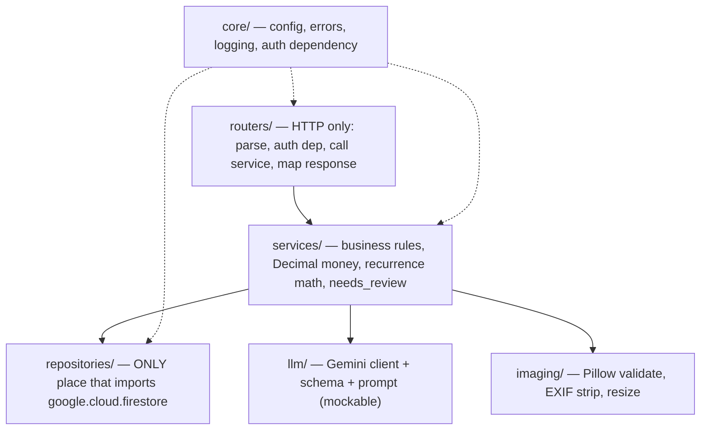

# 03 — Architecture

## System


## Layers (inside the API)


## Request flows
**Scan:** router (multipart) → `imaging` validates and strips the image (in memory only) → rate limit (repository transaction) → `llm.extract()` → schema validation → category mapped to the user's categories, falling back to `Other` → `needs_review` rules → `expenses_repo.create_idempotent`. The image is never persisted or logged.

**Recurring sync:** for each active rule (≤ 20) → one transaction: compute occurrence n from `start` → deterministic id → create if absent → advance `next_index`.

## Package layout (target)
```
app/
  main.py            # app factory, routers, exception handlers
  core/              # config.py, errors.py, logging.py, auth.py, time.py, money.py
  routers/           # health, me, categories, expenses, recurring, summary, scan
  services/          # one per domain
  repositories/      # firestore client + one repo per collection
  llm/               # gemini.py, schema.py, prompt.py
  imaging/           # image.py
  models/            # pydantic API schemas
tests/               # pytest + emulators; fixtures: two users
```
